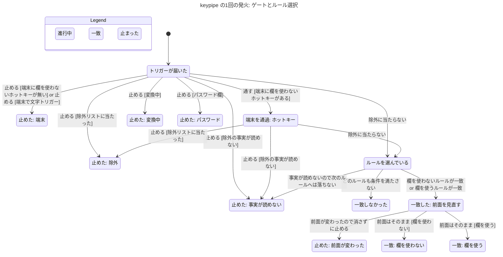
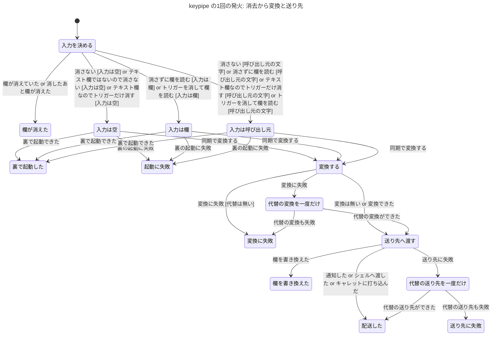
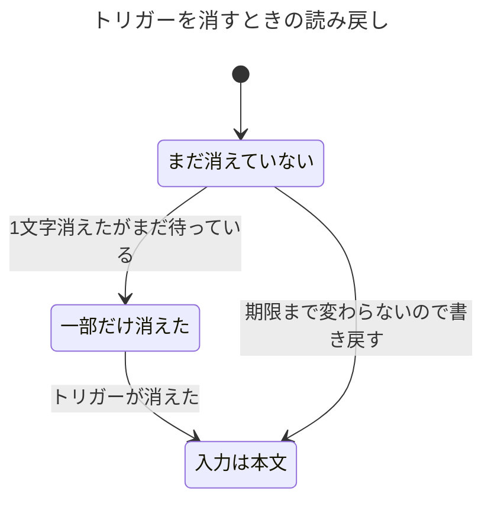
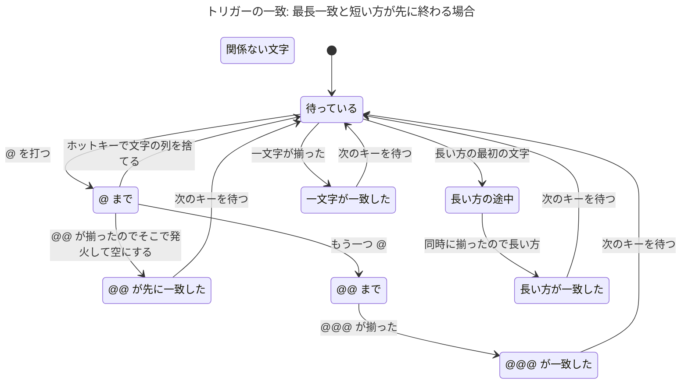

# keypipe の Mac 実装と Windows (C#) 移植の調査

分析のみ。Windows の実装コードは書いていない。対象コミットは `4ee3d7629837f0c066977e90f6287d6bd7be2ee0`（`main`）。確認日は 2026-11-05（日本時間）。

`docs/ideas/IMPLEMENTABILITY-2026-11-01.md` と `docs/design/statechart/` は、今の `Sources/keypipe` より古い。端末がホットキーを止める、`secure` が無い、`when.url` が無い、という記述は現行コードと違う。契約はソースと、この報告書の形式検証が正。

## 形式検証と状態遷移

ツールは TLA+ / TLC 1.7.4。発火は「デスクトップが何と答えるか」の分岐であり、テストが書いた組だけを見るより、モデル検査の方がその組を尽きる。Swift の上で動く検証器は無いので、コードそのものではなく、コードの分岐を一対一にしたモデルを検査した。モデルが今のコードを破る不変条件は無い。

技能は `.claude/skills/verify-keypipe-fire-path/SKILL.md`。実行は次の三つ。

```sh
sh .claude/skills/verify-keypipe-fire-path/check.sh
sh .claude/skills/verify-keypipe-fire-path/mutants.sh
swift test --filter 'testComposingDoesNotFireOrErase|testNoMatchDoesNotEraseOrTryShorterTrigger|testHotkeyReadsFieldWithoutErasingAndIgnoresUnconfiguredChords|testAnySuppliesEmptyInputAndErasesOnlyInTextFields|testTerminalFocusDoesNothingAtAll|testEmptyTransformOutputNotifiesInsteadOfWipingField|testFireRuleRunsOnlyThatRuleWithTheCallersInputInEveryFocus'
```

2026-11-05（日本時間）の結果: check.sh は 4 本とも PASS。状態数は FireGates 83、FireStages 439、EraseReadback 10、TriggerMatch 345。mutants.sh は 16 個の壊したモデルをすべて不変条件が捕まえた。`Engine.fire` の変換中ガードを無効にした一時変更は `testComposingDoesNotFireOrErase` を失敗させた（行が `keypipe composing @@@` ではなく `keypipe nomatch @@@`）。`evaluate` が変換中をまだ拒否するので、シェルは走らない。ガードは元に戻し、テストは再び成功した。`Sources/` は変更していない。

スピナーとピルの順序は既存の `.claude/skills/verify-keypipe-hud-flow/` が別モデルで見ている。今回は再検査していない。

図は次の四つ。現行コードに不変条件の破れは無く、赤い状態は無い。

| 図 | 状態数 | 矢印 | Mermaid | SVG | TLC の報告 |
| --- | --- | --- | --- | --- | --- |
| ゲートとルール選択 | 13 状態 / 16 矢印 | [chart.mmd](fire-path/gates/chart.mmd) | [chart.svg](fire-path/gates/chart.svg) | [report.md](fire-path/gates/report.md) |
| 消去・変換・送り先 | 15 / 23 | [chart.mmd](fire-path/stages/chart.mmd) | [chart.svg](fire-path/stages/chart.svg) | [report.md](fire-path/stages/report.md) |
| 消去の読み戻し | 3 / 3 | [chart.mmd](fire-path/erase/chart.mmd) | [chart.svg](fire-path/erase/chart.svg) | [report.md](fire-path/erase/report.md) |
| トリガー一致 | 9 / 19 | [chart.mmd](fire-path/trigger/chart.mmd) | [chart.svg](fire-path/trigger/chart.svg) | [report.md](fire-path/trigger/report.md) |

図が描かないもの: ゲート内部の「端末ではない」「変換中ではない」「パスワードではない」の通過（ラベルが変わらない）、終了状態の空ステップ、送り先 `none`（通知やシェルと同じ「配送した」に着く）、消去待ちの途中の自己遷移、関係ない文字のあいだの打鍵。各状態へは開始から矢印が届き、外へ出る状態には矢印が残っている。送り先の図は約 23 本で、目安の 20 本を少し超える。

### ゲートとルール選択





### 消去、変換、送り先





`none` の矢印は「配送した」へ着くため図から省いた。

### 消去の読み戻し





### トリガー一致





`@@` と `@@@` が両方有効だと、2 文字目で短い方が発火してバッファが空になる。長い方だけなら 3 文字目で `@@@` が一致する。同じ打鍵で両方が接尾辞になるときは長い方が勝つ（図の「長い方が一致した」）。

## 1. アーキテクチャ

入口は `Sources/keypipe/main.swift` の引数解析一つ（`takesValue` / `alone` / `modes`）。不正な引数は設定を読む前に終了コード 2。

| モード | デスクトップ | どこで終わるか |
| --- | --- | --- |
| `--job` | `LineDesktop`（欄なし） | `runJobProcess`。親が渡したバイト列を再パースする |
| `--probe` | macOS なら `MacDesktop` | JSON 1 行。Linux は `trusted: false` のまま |
| `--triggers` | なし | 文字トリガーを一行ずつ |
| `--line` / `--rule` | `LineDesktop` | 標準入力が入力。`--report` なら `FireResult.reportJSON` |
| `--smoke-feed` / `--smoke-hotkey` | `FakeDesktop` | 一致があれば 0、無ければ 2 |
| `--feed-stdin` | `FakeDesktop` | EOF まで |
| 引数なし | macOS だけ `MacDesktop` + `MacKeyTap` | Linux は終了コード 1 |

デーモン（`main.swift` の `os(macOS)` 枝）は Accessibility が無いと起動しない。`MacKeyTap` は listen-only の `CGEventTap`。コールバックは `DispatchQueue(label: "keypipe.engine")` に渡し、そのキューの中で `LiveConfig.poll` のあと `Engine.key` か `Engine.hotkey`。`NSApplication` は `.accessory`（Dock にもメニューバーにも出さない）。タップが自分の Backspace を見ない印は `keypipeEventTag`（`MacDesktop.swift`）。

`Desktop`（`Desktop.swift`）が移植境界。原始操作は `snapshot`、`backspace`、`text`、`setText`、`notify`、`fact`、`typeText`、`sameField`、`showBusy`、`hideBusy`、`showFired`。消去と書き込みの手順は `Engine.performErase` と `performWrite` に一度だけある。実装は三つ。

- `MacDesktop` / `MacKeyTap`: `#if os(macOS)`。AX と CGEvent はここから出ない。
- `FakeDesktop`: JSON の偽デスクトップ。Linux の `--smoke-feed` と単体テスト。
- `LineDesktop`: zsh の `--line` と、背景ジョブ。`typeText` は既定の `false`。

発火の手順は `Engine` だけが持つ。`TriggerMatcher` は一致した文字列を返すだけで、ルール選択は `Engine.fire` の候補ループ。`evaluate`（`Context.swift`）は focus のあと、`FactSheet` が事実を安い順に一度だけ読む。

シェルは `Shell.runShell`。`/bin/sh -c`、引数は `keypipe` と入力（`$0` と `$1`）、環境変数 `KEYPIPE_INPUT`。期限でプロセスグループを `SIGTERM`、1 秒後に `SIGKILL`。標準出力の末尾改行を一つ落とす。通知は `notifyUser` が `osascript display notification`。背景ジョブは `spawnDetached` で自分のセッションを作り、`keypipe --job` を再実行する（`Job.swift`）。

## 2. 機能一覧

Mac 専用は `#if os(macOS)` のファイルと、デーモン枝。それ以外は Linux の `swift test` が実行する。

| 能力 | 持ち主 | 区分 |
| --- | --- | --- |
| 引数、終了コード、モード排他 | `main.swift` | 共有 |
| JSON 検証、`LiveConfig.poll` | `Config.swift` の `loadConfig` | 共有。真偽値の判定だけ Darwin と Linux で分岐 |
| 文字トリガー、ホットキー字句 | `Trigger.swift` の `TriggerMatcher`、`Hotkey` | 共有 |
| 発火、消去、変換、`onFail`、報告 | `Engine`、`FireResult`、`Report.swift` | 共有 |
| `when` / `deny` / glob | `Facts.swift` の `FactName`、`Conditions`、`FactSheet`。`fnmatch` | 共有。事実の読み手は Mac |
| 組み込み送り先 | `Sinks.swift` の `BuiltinSink` | 共有。副作用は `Desktop` |
| シェル、切り離し、通知 | `Shell.swift` | 共有だが中身は POSIX と `osascript` |
| 偽デスクトップ | `FakeDesktop` | 共有 |
| 行ブリッジ | `LineDesktop`、`shell/keypipe.zsh` | ロジックは共有。widget は zsh |
| キー取得 | `MacKeyTap` | Mac |
| 前面アプリ、AX、Backspace、`typeText`、URL、pty、HUD | `MacDesktop`、`BusySpinner`、`FiredHUD`、`ownsPtyMaster` | Mac |
| `--probe` の実スナップショット、`--line` の既定アプリ | `main.swift` の macOS 枝、`NSWorkspace` | Mac |
| 選択範囲を Claude に渡す | `shell/herdr-claude.sh` | Mac のシェル。エンジンは選択を読まない |

利用者から見えるもの: メニューバー無しの常駐、`~/.config/keypipe/config.json`（`XDG_CONFIG_HOME`）、キーごとに設定を読み直す、トリガーとホットキー、`when.focus`、`when.app`、`when.url`、`deny`、パスワード欄では何もしない、IME 変換中は発火しない、端末の文字トリガーは発火しない、変換、`replaceInput` / `notify` / `none` / `typeText` / `output.shell` / `background`、`onFail`、`shellTimeout`（既定 30 秒）、`backgroundTimeout`（既定 300 秒）、`hud`、`--rule`、`--report` の `v:1`、zsh の `--line`。

設計が扱わないもの: 選択テキスト。`herdr-claude.sh` は合成の Cmd+C で選択を取るので、エンジンの外。`kAXSelectedTextRange` はキャレット位置の HUD 用で、選択の置換ではない。

## 3. プラットフォーム依存

難易度は、Mac の観測済みの挙動を Windows で同じ契約にできるか、で見ている。

| Mac | コード | Windows で対応しそうなもの | 難易度 | リスクと未決 |
| --- | --- | --- | --- | --- |
| listen-only `CGEventTap` | `MacKeyTap` | `WH_KEYBOARD_LL`。必ず `CallNextHookEx`。コールバックはすぐ返す | 中 | 低 IL のプロセスは高 IL（昇格した窓）のキーを見ない（UIPI）。フックが遅いと Windows が外す。自動リピートは Mac が `keyboardEventAutorepeat == 0` で落とす。LL フックに同じフラグは無く、押下中かで見る |
| 自分の打鍵を無視 | `eventSourceUserData` = `keypipeEventTag` | `SendInput` の `dwExtraInfo` に印。注入フラグ全部を捨てると他の道具の打鍵まで消える | 低 | 印の値を決めるだけ |
| 文字は配列から | `UCKeyTranslate`、shift だけ、デッドキー無し | `ToUnicodeEx`。状態を保存して戻す | 高 | `ToUnicodeEx` はデッドキー状態を壊す。JIS の `@` は仮想キー名ではなく、今の配列が出す文字。`cmd` は Mac の Command。スキーマを増やさず、Windows では Windows キーに割り当てるのが互換 |
| Backspace で消す | 仮想キー 51、5 ms 間隔、印付き | `VK_BACK` の `SendInput` | 中 | アプリが無視する。Mac と同じく読み戻しが要る |
| 欄の読み書き | `AXValue`、200 ms 待つ | UI Automation の `ValuePattern`。駄目なら `TextPattern` や `IAccessible` | 高 | Chromium / Electron / コンソール / UWP で割れる。Mac は「全選択して貼る」を未検証として作っていない。同じ判断を守る |
| キャレットへ打つ | Unicode の `CGEvent`、20 UTF-16 単位、フラグを空に、印付き | `KEYEVENTF_UNICODE`、修飾を外す、印付き | 中 | ホットキーの修飾が押されたままだとショートカットになる。Mac は `event.flags = []` |
| IME 変換中 | `AXTextInputMarkedRange` の長さが正 | IMM の `ImmGetCompositionString` と、TSF。Chromium は TSF | 高 | 検出できないアプリでは Mac と同じく変換中のかなを消す。最初のスライスで Notepad と Chromium と Microsoft IME を測るまでゲートの実装を確定しない |
| パスワード | `AXSecureTextField` | UIA のパスワード、または `ES_PASSWORD` | 中 | 変換中より前ではなく、Mac と同じ順（端末、変換中、パスワード） |
| 端末 | `/dev/ptmx` を開いているプロセス | 相当の単一ハンドルは無い。`ConsoleWindowClass` と Windows Terminal のクラス | 高 | Mac は bundle id の表を拒否して pty にした。Windows はクラスの小さい表になり、設計のやり直し。文字トリガーは止め、`focus: any` のホットキーだけ通す契約は守れる |
| 前面アプリ | bundle id | イメージ名（`notepad.exe`）か AUMID。Win11 のメモ帳はパッケージ | 高 | `when.app` の値は OS をまたいで同じにできない。キー名は残す |
| URL | 既知ブラウザへ `osascript`、1 秒 | アドレスバーの UIA。名前は日本語 Windows で変わる | 高 | 読めないときに発火を止める（落ちない）契約は、読み手を後で足すときも守る。最初のスライスでは事実を足さない |
| 通知 | `osascript` | トースト。トレイアイコンはメニューバーに当たるので付けない | 低 | 文言は引数で渡し、スクリプト文字列に埋め込まない |
| Accessibility 許可 | `AXIsProcessTrusted`。起動時に拒否。`--probe` は促さない | 通常のフックと UIA に単一の許可スイッチは無い。`uiAccess` は署名と Program Files が要る | 中 | 昇格した対象は非昇格の keypipe から触れない。UAC 画面には打たない |
| HUD | `NSPanel`、非アクティブ、マウス透過。成功 1.5 秒、失敗 3 秒。配置はコメントが `MAC_UNVERIFIED` | 同様のレイヤードウィンドウ | 中 | 描画は後回し。`Engine.showFiredIfNeeded` がピルを頼む条件は共有 |
| プロセスグループの期限 | `kill(-pid)` | Job Object で木を殺す | 中 | `timeout` の意味（段の期限と、背景ジョブ全体の期限）を保つ |
| 設定パス | `XDG_CONFIG_HOME` または `~/.config/keypipe/config.json`。ログは `~/.local/state/keypipe/` | 同じ規則。空の環境変数は未設定扱い | 低 | AppData に移すと文書とずれる |

## 4. 設定とルールの意味（Windows が保つ契約）

スキーマのキーは保つ。`when.app` の中身と、シェルが `/bin/sh` であることは Mac の値であり、同じ JSON をそのまま Windows で実行できるとは限らない。

- ルールは `trigger` か `hotkey` の片方。`trigger` は直近の打鍵の接尾辞、最大 64 文字（`triggerMaxBuffer`）。同じバッファでは最長が勝つ。同じ文字列では設定順で、`when` を満たす最初。満たすものが無ければ短いトリガーへは落ちない。`@@` と `@@@` が両方あると、短い方が先に完成して発火し、バッファが空になる（上のトリガー図）。
- `hotkey` は修飾が最低一つ。`ctrl`/`control`、`alt`/`option`、`cmd`/`command`。shift は修飾ではなく文字（`ctrl+A`）。キーは 1 文字（`+` は `ctrl++`）。ホットキーは消さない（`erase 0`）。`textField` なら欄全体、`any` なら空。設定に無いコード（Cmd+C）はデスクトップに触れず、ログも出さない。タップは listen-only なので前面のアプリもコードを受け取る。
- `when.focus` は `textField` か `any`（既定）。`textField` はテキスト欄のときだけ。トリガーを消し、消したあとの欄が入力。`replaceInput` はこのときだけ設定できる。`any` はどこでも発火し、入力は空。テキスト欄ならトリガーだけ消し、欄は入力にしない。欄でなければ Backspace も送らない。
- 変換中と端末とパスワードは `when` の値ではない。ゲートである。端末では文字トリガーを全部捨て、`focus: any` のホットキーだけ残す。`evaluate` は端末を不一致にするので、その例外は `Engine.fire` が条件だけを見る。
- `when.app` と `when.url` は glob の配列（`fnmatch`、`*` は `/` をまたぐ）。空配列は拒否。省略はワイルドカード。`url` は遅い事実で、安い条件が揃ってから一度だけ読む。読めなければ次のルールへ落ちず、発火を止める。ブラウザでなければ不一致。`--line` と `--rule` は生きた事実を読まないので、`url` は不一致であり、止めもしない。
- `deny` は focus を持たない `when` の配列。当たればルールの前、欄を読む前に止まる。`url` には `app` が必要。読めない `url` も止まる。`--line` / `--rule` では `url` の deny は当たらない。
- `transform` は任意。`/bin/sh -c`。入力は stdin と `$1` と `KEYPIPE_INPUT`。前面アプリは `KEYPIPE_APP`。標準出力から末尾改行を一つ落とす。非ゼロ、期限、空出力は失敗。`onFail.transform` が同じ入力で一度。無ければ配送せず通知する。
- `output` は `replaceInput`、`typeText`、`notify`、`none`（既定）、または `{ "shell" }`。`background: true` は主の `output.shell` だけ。呼び出し元はすぐ戻り、切り離したジョブが変換と送り先と `onFail` を行い、`jobs.log` に追記する。失敗すると通知する。
- `typeText` は印付きのキーで打つ。`--line` / `--rule` はキャレットが無く `unsupported`。変換中に前面が変わったら `gone`。
- `onFail.output` は失敗できる送り先にだけ。`KEYPIPE_FAILURE` は `exit N`、`timeout`、`empty`、`ignored`、`gone`、`unsupported`。代替の代替は無い。`onFail` が無く `replaceInput` が失敗したら、結果を通知して失わない。失敗した `output.shell` はログだけ（背景ジョブは通知する）。
- 期限: 消去の前にトリガーが欄に着くまで 100 ms（5 ms 刻み）。Backspace の読み戻し 200 ms。`setText` の読み戻し 200 ms。シェルは `shellTimeout`。背景ジョブ全体は `backgroundTimeout`。
- `name` は一意で `--rule` の選択子。`label` は表示だけ。ピルの文言は label、name、シェル、組み込み名の順。空白を畳んで 40 書記素。`hud` 既定 true。成功と背景開始は 1.5 秒、失敗は 3 秒。`--line`、`--rule`、`--job`、Linux はピルを描かないが、行は出る。
- 終了コード: 引数 2（設定の前）。不明な `--rule` 名は読んだあと 2 で、`--report` でも標準出力は空。不正な設定は 1。`--smoke-feed` は段が失敗しても一致なら 0、不一致なら 2。`--line` は一致 0、それ以外 2。`--report` は報告を書けたら 0（blocked や nomatch も含む）。
- `--report` の `v` は 1。結果は `replaced`、`delivered`、`started`、`failed`、`nomatch`、`blocked`（`terminal`、`composing`、`secure`、`deny`、`front-changed`）、`unreadable`、`noinput`。金のファイルは `Tests/keypipeTests/Fixtures/report-v1.jsonl`。

## 5. テスト

`FakeDesktop` は本番の `Desktop` を実装する。`--context` の JSON は `app`、`focusIsTextField`、`fieldText`、`composing`、`ignoresBackspace`、`backspacePerRead`、`keysPerRead`、`ignoresWrite`、`fieldGoneAfter`、`writePerRead`、`ownsPty`、`secure`、`facts`、`unreadableFacts`、`appAfterSlowRead`。`composing` かつ欄でないのは拒否。打鍵は `fieldText` の末尾に足し、Backspace は末尾から消す。

`swift test` はエンジンに偽デスクトップと偽シェルを渡す。Linux で動く。実機の AX とタップは `.claude/skills/verify-keypipe-rules/verify.sh` の M 項目（Mac、Accessibility）。`--no-live` はどこでも動く。

共有してよいもの: 上の JSON フィクスチャ、`report-v1.jsonl`、形式検証の不変条件。Swift のテストそのものは C# から実行できない。Windows は同じシナリオを C# で書き直す。

Windows が別に要るもの: フック、UIA、IME、UIPI、コンソールクラス、トースト。偽デスクトップの単体テストが緑になってから測る。

## 6. 推奨する C# の形

同じリポジトリに、Swift パッケージとは別のソリューションを置く。`Sources/keypipe` は共有バイナリにしない。純な手順を C# で写し、JSON フィクスチャと TLA の不変条件を両方のテストが使う。

- `Keypipe.Core`: `loadConfig` に相当する検証、`TriggerMatcher`、`Hotkey`、`Engine` の発火、`FactSheet`、`FireResult` と report v1、送り先の失敗集合。デスクトップとシェルはインターフェース。
- `Keypipe.Core.Tests`: 偽デスクトップ。最初の完了条件は、上の四つのモデルが述べる不変条件が C# のテストで落ちること。
- `Keypipe.Windows`: 低レベルフック、UIA、`SendInput`、プロセス名、トースト、後で HUD。exe はトレイ無し。
- シェル実行は Core のインターフェース。Windows 実装は、PATH に POSIX の `sh` があるときだけ Mac と同じ argv（`sh -c`、`$0=keypipe`、`$1=入力`）を使う。`cmd` や PowerShell を既定にすると、今の設定のクォートが別物になる。`osascript` と `pbcopy` は移植の一部ではない。クリップボードは利用者がシェルに書くか、後で組み込みにする。

最初の到達点（機能同等の手前）: フック無しで、偽デスクトップに対して `--smoke-feed` と同じ発火が動くこと。不変条件は ComposingStops から HandsBody まで。その次の一本は、メモ帳のテキスト欄だけで、listen-only フック、`@@@`、`ValuePattern` による置換。

後回し: 選択テキスト、`herdr-claude.sh`、zsh に相当する PSReadLine、URL、HUD の見た目、背景ジョブの Job Object、端末クラスの表、IME の実測が終わるまでの「変換中」の確定。ホットキーの配列変換は、メモ帳の一本のあと。

## 7. 結論（この節だけ貼ってよい）

keypipe（コミット `4ee3d76`）は Mac の常駐デーモンである。メニューバーは無い。文字トリガーかホットキーから、前面のテキスト欄を任意で読み、`/bin/sh` で変換し、欄の置換・通知・シェル・`typeText`・背景ジョブへ渡す。設定は一つの JSON。IME 変換中は発火しない。選択テキストはエンジンの対象外。移植境界はすでに `Desktop` プロトコルで、消去と書き込みの手順は `Engine` に閉じている。

同一リポジトリに C# の Windows 対象を置く判断は、条件付きで進めてよい。Swift を共有ライブラリにはしない。`Keypipe.Core` に発火手順を写し、`Keypipe.Windows` にフックと UI Automation と `SendInput` を置く。JSON のキー、終了コード、`--report` の v1、上の不変条件は保つ。`when.app` の bundle id と、変換コマンドが `/bin/sh` であることは Mac の値なので、同じファイルを無修正で Windows 実行する契約にはしない。シェルは POSIX の `sh` があるときだけ Mac と同じ argv にする。

最大の障害は五つ。(1) 設定のシェルが `/bin/sh -c` と `$1`。(2) 欄の読み書きがアプリごとに割れ、Mac は Backspace と AXValue の読み戻し（100 ms と 200 ms）で吸収している。Windows は UIA と `SendInput` で同じ二段が要る。(3) IME。Mac は `AXTextInputMarkedRange`。Windows は IMM と TSF が分かれ、検出できないと変換中のかなを消す。(4) UIPI。昇格した窓には通常権限からフックも UIA も `SendInput` も届かない。(5) アプリ識別子。`when.app` は bundle id。Windows はイメージ名か AUMID で、値は共有できない。

最初のスライスはフックを書かない。偽デスクトップの上で、形式検証（`.claude/skills/verify-keypipe-fire-path/`、図は `artifacts/fire-path/`）が固定した発火が C# で再現すること。その次がメモ帳だけの `@@@` から `ValuePattern` 置換。選択、端末、URL、HUD、背景ジョブ、IME の確定はそれより後。実装はこの調査には含めない。

モデル検査の再実行と、コードが動いたあとの追随は `/maintain-formal-verification-skill`。TLC の出力は毎回 `/statechart` で読む。
