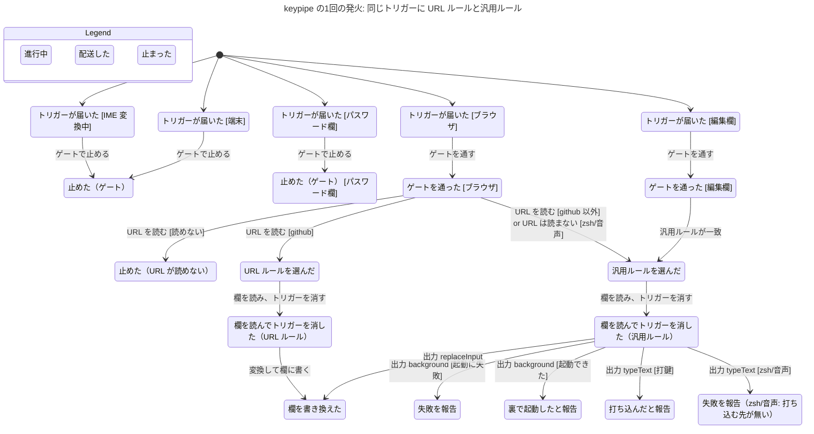

# 発火の状態遷移図（改修前 → 改修後）

`docs/design/extension-architecture.md` の改修で、1回の発火の振る舞いがどう変わるかを TLA+ のモデルで示す。同じトリガーに「URL ルール」（ブラウザで GitHub のときだけ）と「汎用ルール」の2つがある設定で、トリガーが届いてから結果が出るまでを追う。

- `KeypipeFire.tla`: モデル。定数 `After` が FALSE なら改修前、TRUE なら改修後。
- `before.cfg` / `after.cfg`: 検査する規則は同じ4つ（下表）。
- `view.mjs`: 図の言葉。
- `before.mmd` / `after.mmd`: 生成した図。`*-report.md` は規則ごとの結果と、破れた経路。

## 検査する規則（verify-keypipe-trigger の計画項目に対応）

| 規則 | 読み手の言葉 | 計画項目 | 改修前 | 改修後 |
|---|---|---|---|---|
| NoReadInSecureField | パスワード欄は読まない | P6 | 破れる | 成り立つ |
| UnreadableNeverFallsThrough | URL が読めなかったとき、次のルールに落ちない | P5 | 破れる | 成り立つ |
| NoFakeTypeText | zsh・音声の経路で typeText が「打ち込んだ」と報告しない | P10 | 破れる | 成り立つ |
| StartedMeansSpawned | 「裏で起動した」と報告するのは本当に起動したときだけ | P2 | 破れる | 成り立つ |

「改修前」は、レビュー前のスケッチ（候補2の原形）を今のコードの上に置いたもの。今のコードには `when.url` も typeText も無いので、現行コードそのものではない。

## 改修前から改修後になったことの確かめ方

実装の PR を出すたびに、次を順に確かめる。

1. `after.cfg` で4つの規則がすべて成り立つこと（図 `after.mmd` と同じ形になる）。
2. `before.cfg` で4つの規則が破れること（図 `before.mmd` の赤い状態）。これは「規則が破れを見つけられる」ことの確認で、モデルを緩めていない証拠になる。
3. `before-report.md` の各経路を、実装前のコードに対して1ステップずつ再現できること。再現できなければモデルが間違っている。
4. 実コードでは `verify-keypipe-trigger` の P2・P5・P6・P10 が同じ性質を検査する。

図を作り直すコマンド（`--out` は毎回新しいフォルダにする）:

```sh
~/.claude/skills/statechart/scripts/statechart docs/design/statechart/KeypipeFire.tla \
  --config docs/design/statechart/before.cfg --view docs/design/statechart/view.mjs --out /tmp/kp-before
~/.claude/skills/statechart/scripts/statechart docs/design/statechart/KeypipeFire.tla \
  --config docs/design/statechart/after.cfg --view docs/design/statechart/view.mjs --out /tmp/kp-after
```

## 改修前に破れる経路（before-report.md より）

- **URL が読めなかったとき、次のルールに落ちない**（2ステップ）: トリガーが届いた [ブラウザ] → ゲートを通す → URL を読む [読めない → 次のルールへ] → 汎用ルールを選んだ [URL が読めないまま]。害: GitHub 用の整形のつもりが、汎用ルールの変換に化ける。
- **パスワード欄は読まない**（3ステップ）: トリガーが届いた [パスワード欄] → ゲートを通す → 汎用ルールが一致 → 欄を読み、トリガーを消す。害: パスワードが transform の shell に渡る。
- **「裏で起動した」は本当に起動したときだけ**（4ステップ）: 編集欄 → ゲート → 汎用ルール → 欄を読む → 出力 background [起動に失敗] → 裏で起動したと報告、実際は起動していない。害: voice-switch が「配送済み」と記録するが、何も走っていない。
- **typeText の偽の成功**（4ステップ）: 編集欄 → ゲート → 汎用ルール → 欄を読む → 出力 typeText [zsh/音声] → 打ち込んだと報告（打ち込む先が無い）。害: 音声の本文が消える。

## モデルが省いているもの

- transform の段（失敗・timeout・onFail）。R5・R9 の挙動検査に任せる。
- `deny`（P7）、遅い事実を読む間に前面が変わる競合（R12f）、M18（端末前面の `focus: any`）。モデルの端末ゲートは改修前後とも全ルールを止める。
- 消去と書き戻しのポーリング（R4）。改修で触らない。
- 図は `Done`（終了状態で何もしない遷移）を描いていない。

## 改修前の図

```mermaid
---
title: "keypipe の1回の発火: 同じトリガーに URL ルールと汎用ルール"
---
stateDiagram-v2
  state "Legend" as legend {
    lg0: 進行中
    lg1: 配送した
    lg2: 止まった
    lg3: Breaks NoFakeTypeText or NoReadInSecureField or StartedMeansSpawned or UnreadableNeverFallsThrough
    lg4: Path to the NoFakeTypeText or NoReadInSecureField or StartedMeansSpawned or UnreadableNeverFallsThrough bug
  }
  class lg0 blue
  class lg1 teal
  class lg2 orange
  class lg3 breaks
  class lg4 bugPath
  s0: トリガーが届いた [ブラウザ]
  s1: トリガーが届いた [IME 変換中]
  s2: トリガーが届いた [編集欄]
  s3: トリガーが届いた [パスワード欄]
  s4: トリガーが届いた [端末]
  s5: 止めた#65288;ゲート#65289;
  s6: ゲートを通った [ブラウザ]
  s7: ゲートを通った [編集欄]
  s8: ゲートを通った [パスワード欄]
  s9: URL ルールを選んだ
  s10: 汎用ルールを選んだ
  s11: 汎用ルールを選んだ [パスワード欄]
  s12: 汎用ルールを選んだ [URL が読めないまま]
  s13: 欄を読んでトリガーを消した#65288;URL ルール#65289;
  s14: 欄を読んでトリガーを消した#65288;汎用ルール#65289;
  s15: 欄を読んでトリガーを消した#65288;汎用ルール#65289; [パスワード欄]
  s16: 欄を読んでトリガーを消した#65288;汎用ルール#65289; [URL が読めないまま]
  s17: 裏で起動したと報告#12289;実際は起動していない
  s18: 裏で起動したと報告#12289;実際は起動していない [パスワード欄]
  s19: 裏で起動したと報告#12289;実際は起動していない [URL が読めないまま]
  s20: 欄を書き換えた
  s21: 裏で起動したと報告
  s22: 打ち込んだと報告
  s23: 裏で起動したと報告 [パスワード欄]
  s24: 欄を書き換えた [パスワード欄]
  s25: 打ち込んだと報告 [パスワード欄]
  s26: 打ち込んだと報告#65288;zsh/音声: 打ち込む先が無い#65289;
  s27: 打ち込んだと報告#65288;zsh/音声: 打ち込む先が無い#65289; [パスワード欄]
  s28: 裏で起動したと報告 [URL が読めないまま]
  s29: 欄を書き換えた [URL が読めないまま]
  s30: 打ち込んだと報告 [URL が読めないまま]
  [*] --> s0
  [*] --> s1
  [*] --> s2
  [*] --> s3
  [*] --> s4
  s0 --> s6: ゲートを通す
  s1 --> s5: ゲートで止める
  s2 --> s7: ゲートを通す
  s3 --> s8: ゲートを通す
  s4 --> s5: ゲートで止める
  s6 --> s9: URL を読む [github]
  s6 --> s10: URL を読む [github 以外] or URL は読まない [zsh/音声]
  s6 --> s12: URL を読む [読めない #8594; 次のルールへ]
  s7 --> s10: 汎用ルールが一致
  s8 --> s11: 汎用ルールが一致
  s9 --> s13: 欄を読み#12289;トリガーを消す
  s10 --> s14: 欄を読み#12289;トリガーを消す
  s11 --> s15: 欄を読み#12289;トリガーを消す
  s12 --> s16: 欄を読み#12289;トリガーを消す
  s13 --> s20: 変換して欄に書く
  s14 --> s17: 出力 background [起動に失敗]
  s14 --> s21: 出力 background [起動できた]
  s14 --> s20: 出力 replaceInput
  s14 --> s22: 出力 typeText [打鍵]
  s15 --> s18: 出力 background [起動に失敗]
  s15 --> s23: 出力 background [起動できた]
  s15 --> s24: 出力 replaceInput
  s15 --> s25: 出力 typeText [打鍵]
  s14 --> s26: 出力 typeText [zsh/音声]
  s15 --> s27: 出力 typeText [zsh/音声]
  s16 --> s19: 出力 background [起動に失敗]
  s16 --> s28: 出力 background [起動できた]
  s16 --> s29: 出力 replaceInput
  s16 --> s30: 出力 typeText [打鍵]
  classDef breaks fill:#ffecee,stroke:#e72e3b,stroke-width:2.5px,color:#cd2834
  class s0 blue
  class s0 bugPath
  class s1 blue
  class s2 blue
  class s2 bugPath
  class s3 blue
  class s3 bugPath
  class s4 blue
  class s5 orange
  class s6 blue
  class s6 bugPath
  class s7 blue
  class s7 bugPath
  class s8 blue
  class s8 bugPath
  class s9 blue
  class s10 blue
  class s10 bugPath
  class s11 blue
  class s11 bugPath
  class s12 blue
  class s12 breaks
  class s12 bugPath
  class s13 blue
  class s14 blue
  class s14 bugPath
  class s15 blue
  class s15 breaks
  class s15 bugPath
  class s16 blue
  class s16 breaks
  class s17 teal
  class s17 breaks
  class s17 bugPath
  class s18 teal
  class s18 breaks
  class s19 teal
  class s19 breaks
  class s20 teal
  class s21 teal
  class s22 teal
  class s23 teal
  class s23 breaks
  class s24 teal
  class s24 breaks
  class s25 teal
  class s25 breaks
  class s26 teal
  class s26 breaks
  class s26 bugPath
  class s27 teal
  class s27 breaks
  class s28 teal
  class s28 breaks
  class s29 teal
  class s29 breaks
  class s30 teal
  class s30 breaks
```



## 改修後の図


