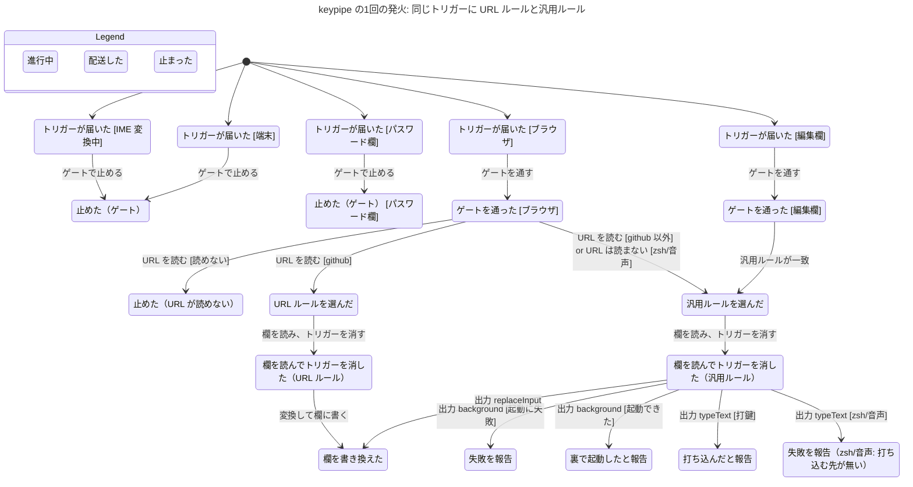

# 発火の状態遷移図（改修前 → 改修後）

`docs/design/extension-architecture.md` の改修で、1回の発火の振る舞いがどう変わるかを TLA+ のモデルで示す。同じトリガーに「URL ルール」（ブラウザで GitHub のときだけ）と「汎用ルール」の2つがある設定で、トリガーが届いてから結果が出るまでを追う。

- `KeypipeFire.tla`: モデル。定数 `After` が FALSE なら改修前、TRUE なら改修後。
- `before.cfg` / `after.cfg`: 検査する規則は同じ4つ（下表）。
- `view.mjs`: 図の言葉。
- `before.mmd` / `after.mmd`: 生成した図。`*-report.md` は規則ごとの結果と、破れた経路。
- `SelectionCapture.tla` と `selection-*`: テキスト選択の取り込み（`shell/selection-prompt.sh`）の図。末尾の「テキスト選択時の流れ」を参照。

## 検査する規則（verify-keypipe-trigger の計画項目に対応）

| 規則 | 読み手の言葉 | 計画項目 | 改修前 | 改修後 |
|---|---|---|---|---|
| NoReadInSecureField | パスワード欄は読まない | P6 | 破れる | 成り立つ |
| UnreadableNeverFallsThrough | URL が読めなかったとき、次のルールに落ちない | P5 | 破れる | 成り立つ |
| NoFakeTypeText | zsh・音声の経路で typeText が「打ち込んだ」と報告しない | P10 | 破れる | 成り立つ |
| StartedMeansSpawned | 「裏で起動した」と報告するのは本当に起動したときだけ | P2 | 破れる | 成り立つ |

「改修前」は、レビュー前のスケッチ（候補2の原形）を今のコードの上に置いたもの。今のコードには `when.url` も typeText も無いので、現行コードそのものではない。

## 改修前から改修後になったことの確かめ方

実装の PR を出すたびに、次を順に確かめる。

1. `after.cfg` で4つの規則がすべて成り立つこと（図 `after.mmd` と同じ形になる）。
2. `before.cfg` で4つの規則が破れること（図 `before.mmd` の赤い状態）。これは「規則が破れを見つけられる」ことの確認で、モデルを緩めていない証拠になる。
3. `before-report.md` の各経路を、実装前のコードに対して1ステップずつ再現できること。再現できなければモデルが間違っている。
4. 実コードでは `verify-keypipe-trigger` の P2・P5・P6・P10 が同じ性質を検査する。

図を作り直すコマンド（`--out` は毎回新しいフォルダにする）:

```sh
~/.claude/skills/statechart/scripts/statechart docs/design/statechart/KeypipeFire.tla \
  --config docs/design/statechart/before.cfg --view docs/design/statechart/view.mjs --out /tmp/kp-before
~/.claude/skills/statechart/scripts/statechart docs/design/statechart/KeypipeFire.tla \
  --config docs/design/statechart/after.cfg --view docs/design/statechart/view.mjs --out /tmp/kp-after
```

## 改修前に破れる経路（before-report.md より）

- **URL が読めなかったとき、次のルールに落ちない**（2ステップ）: トリガーが届いた [ブラウザ] → ゲートを通す → URL を読む [読めない → 次のルールへ] → 汎用ルールを選んだ [URL が読めないまま]。害: GitHub 用の整形のつもりが、汎用ルールの変換に化ける。
- **パスワード欄は読まない**（3ステップ）: トリガーが届いた [パスワード欄] → ゲートを通す → 汎用ルールが一致 → 欄を読み、トリガーを消す。害: パスワードが transform の shell に渡る。
- **「裏で起動した」は本当に起動したときだけ**（4ステップ）: 編集欄 → ゲート → 汎用ルール → 欄を読む → 出力 background [起動に失敗] → 裏で起動したと報告、実際は起動していない。害: voice-switch が「配送済み」と記録するが、何も走っていない。
- **typeText の偽の成功**（4ステップ）: 編集欄 → ゲート → 汎用ルール → 欄を読む → 出力 typeText [zsh/音声] → 打ち込んだと報告（打ち込む先が無い）。害: 音声の本文が消える。

## モデルが省いているもの

- transform の段（失敗・timeout・onFail）。R5・R9 の挙動検査に任せる。
- `deny`（P7）、遅い事実を読む間に前面が変わる競合（R12f）、M18（端末前面の `focus: any`）。モデルの端末ゲートは改修前後とも全ルールを止める。
- 消去と書き戻しのポーリング（R4）。改修で触らない。
- 図は `Done`（終了状態で何もしない遷移）を描いていない。

## 改修前の図

```mermaid
---
title: "keypipe の1回の発火: 同じトリガーに URL ルールと汎用ルール"
---
stateDiagram-v2
  state "Legend" as legend {
    lg0: 進行中
    lg1: 配送した
    lg2: 止まった
    lg3: Breaks NoFakeTypeText or NoReadInSecureField or StartedMeansSpawned or UnreadableNeverFallsThrough
    lg4: Path to the NoFakeTypeText or NoReadInSecureField or StartedMeansSpawned or UnreadableNeverFallsThrough bug
  }
  class lg0 blue
  class lg1 teal
  class lg2 orange
  class lg3 breaks
  class lg4 bugPath
  s0: トリガーが届いた [ブラウザ]
  s1: トリガーが届いた [IME 変換中]
  s2: トリガーが届いた [編集欄]
  s3: トリガーが届いた [パスワード欄]
  s4: トリガーが届いた [端末]
  s5: 止めた#65288;ゲート#65289;
  s6: ゲートを通った [ブラウザ]
  s7: ゲートを通った [編集欄]
  s8: ゲートを通った [パスワード欄]
  s9: URL ルールを選んだ
  s10: 汎用ルールを選んだ
  s11: 汎用ルールを選んだ [パスワード欄]
  s12: 汎用ルールを選んだ [URL が読めないまま]
  s13: 欄を読んでトリガーを消した#65288;URL ルール#65289;
  s14: 欄を読んでトリガーを消した#65288;汎用ルール#65289;
  s15: 欄を読んでトリガーを消した#65288;汎用ルール#65289; [パスワード欄]
  s16: 欄を読んでトリガーを消した#65288;汎用ルール#65289; [URL が読めないまま]
  s17: 裏で起動したと報告#12289;実際は起動していない
  s18: 裏で起動したと報告#12289;実際は起動していない [パスワード欄]
  s19: 裏で起動したと報告#12289;実際は起動していない [URL が読めないまま]
  s20: 欄を書き換えた
  s21: 裏で起動したと報告
  s22: 打ち込んだと報告
  s23: 裏で起動したと報告 [パスワード欄]
  s24: 欄を書き換えた [パスワード欄]
  s25: 打ち込んだと報告 [パスワード欄]
  s26: 打ち込んだと報告#65288;zsh/音声: 打ち込む先が無い#65289;
  s27: 打ち込んだと報告#65288;zsh/音声: 打ち込む先が無い#65289; [パスワード欄]
  s28: 裏で起動したと報告 [URL が読めないまま]
  s29: 欄を書き換えた [URL が読めないまま]
  s30: 打ち込んだと報告 [URL が読めないまま]
  [*] --> s0
  [*] --> s1
  [*] --> s2
  [*] --> s3
  [*] --> s4
  s0 --> s6: ゲートを通す
  s1 --> s5: ゲートで止める
  s2 --> s7: ゲートを通す
  s3 --> s8: ゲートを通す
  s4 --> s5: ゲートで止める
  s6 --> s9: URL を読む [github]
  s6 --> s10: URL を読む [github 以外] or URL は読まない [zsh/音声]
  s6 --> s12: URL を読む [読めない #8594; 次のルールへ]
  s7 --> s10: 汎用ルールが一致
  s8 --> s11: 汎用ルールが一致
  s9 --> s13: 欄を読み#12289;トリガーを消す
  s10 --> s14: 欄を読み#12289;トリガーを消す
  s11 --> s15: 欄を読み#12289;トリガーを消す
  s12 --> s16: 欄を読み#12289;トリガーを消す
  s13 --> s20: 変換して欄に書く
  s14 --> s17: 出力 background [起動に失敗]
  s14 --> s21: 出力 background [起動できた]
  s14 --> s20: 出力 replaceInput
  s14 --> s22: 出力 typeText [打鍵]
  s15 --> s18: 出力 background [起動に失敗]
  s15 --> s23: 出力 background [起動できた]
  s15 --> s24: 出力 replaceInput
  s15 --> s25: 出力 typeText [打鍵]
  s14 --> s26: 出力 typeText [zsh/音声]
  s15 --> s27: 出力 typeText [zsh/音声]
  s16 --> s19: 出力 background [起動に失敗]
  s16 --> s28: 出力 background [起動できた]
  s16 --> s29: 出力 replaceInput
  s16 --> s30: 出力 typeText [打鍵]
  classDef breaks fill:#ffecee,stroke:#e72e3b,stroke-width:2.5px,color:#cd2834
  class s0 blue
  class s0 bugPath
  class s1 blue
  class s2 blue
  class s2 bugPath
  class s3 blue
  class s3 bugPath
  class s4 blue
  class s5 orange
  class s6 blue
  class s6 bugPath
  class s7 blue
  class s7 bugPath
  class s8 blue
  class s8 bugPath
  class s9 blue
  class s10 blue
  class s10 bugPath
  class s11 blue
  class s11 bugPath
  class s12 blue
  class s12 breaks
  class s12 bugPath
  class s13 blue
  class s14 blue
  class s14 bugPath
  class s15 blue
  class s15 breaks
  class s15 bugPath
  class s16 blue
  class s16 breaks
  class s17 teal
  class s17 breaks
  class s17 bugPath
  class s18 teal
  class s18 breaks
  class s19 teal
  class s19 breaks
  class s20 teal
  class s21 teal
  class s22 teal
  class s23 teal
  class s23 breaks
  class s24 teal
  class s24 breaks
  class s25 teal
  class s25 breaks
  class s26 teal
  class s26 breaks
  class s26 bugPath
  class s27 teal
  class s27 breaks
  class s28 teal
  class s28 breaks
  class s29 teal
  class s29 breaks
  class s30 teal
  class s30 breaks
```



## 改修後の図



## テキスト選択時の流れ（selection-prompt.sh）

ホットキー（herdr-claude・grokbot）や `keypipe --rule herdr-claude` で選択を送るとき、1回の取り込みを `SelectionCapture.tla` で追う。定数 `After` が FALSE なら今のスクリプト（`pbpaste` でテキストだけ読む）、TRUE なら計画中の設計（コピーの HTML と `org.chromium.source-url` も読み、HTML が無いときはアクセシビリティで選択範囲のリンクを問い合わせ、元のクリップボードを型ごと戻す）。Chrome で開いた Slack はコピーをテキストだけに差し替えるので（2026-11-06 に確認）、リンク先はアクセシビリティ経由でしか取れない。規則・実現可能性の確認結果・実行方法は `.claude/skills/verify-keypipe-selection-context/SKILL.md` にある。

| 規則 | 読み手の言葉 | 項目 | 今 | 計画 |
|---|---|---|---|---|
| HrefNeverDropped | 文字の裏のリンク先を落とさない | I2 | 破れる | 成り立つ |
| BrowserUrlAttached | ブラウザなら、どのページの文か添える | I3 | 破れる | 成り立つ |
| PageUrlOnlyFromBrowser | ページ URL はブラウザのときだけ（Slack のアプリ URL は添えない） | I4 | 成り立つ | 成り立つ |
| OldClipboardRestored | 元のクリップボードは画像なども含めて戻る | I5 | 破れる | 成り立つ |
| FailedCopyNotSent | Cmd+C が失敗したら送らずに失敗を伝える | I6 | 成り立つ | 成り立つ |

今のスクリプトで破れる経路（`selection-before-report.md` より）:

- **リンク先を落とさない**（5ステップ）: ホットキー [Chrome] → 退避して空にする → Cmd+C（テキスト+HTML+source-url）→ コピーを読む（`pbpaste` はテキストだけ）→ 戻す → プロンプトを出した: リンク先を落とした。害: 「こちら」だけが送られ、リンク先が分からない。
- **ページを添える**（5ステップ）: 同じ経路で、source-url がコピーにあるのに読まない。害: どのページの文か Claude に伝わらない。
- **元のクリップボードを戻す**（4ステップ）: ホットキー → 退避（テキストだけ）→ Cmd+C 失敗 → 戻す [画像などが消えた] → exit 1。害: 送る前にコピーしていた画像が消える。

図を作り直すときは `/statechart` スキルに `SelectionCapture.tla`、設定 `selection-before.cfg` か `selection-after.cfg`、図の言葉 `selection-view.mjs` を渡し、出力の `chart.mmd` と `report.md` を `selection-*.mmd` と `selection-*-report.md` に写す。省いたもの: ロック、2回の送信の競合、音声入力、送り先（`verify-keypipe-failure-report` が実コードで検査する）。図は Slack デスクトップ版と Safari が書く型、および Chrome 以外でのアクセシビリティの答えを未検証として、ありうる組み合わせをすべて描く。

### 計画の図

```mermaid
---
title: "テキスト選択の1回の取り込み: selection-prompt.sh"
---
stateDiagram-v2
  state "Legend" as legend {
    lg0: 進行中
    lg1: 送った
    lg2: 止まった
  }
  class lg0 blue
  class lg1 teal
  class lg2 orange
  s0: ホットキーが届いた [Chrome]
  s1: ホットキーが届いた [テキストだけのアプリ]
  s2: ホットキーが届いた [Safari]
  s3: ホットキーが届いた [Slack]
  s4: 退避して空にした [Chrome]
  s5: 退避して空にした [テキストだけのアプリ]
  s6: 退避して空にした [Safari]
  s7: 退避して空にした [Slack]
  s8: Cmd+C が失敗した
  s9: コピーされた: テキスト [ブラウザ]
  s10: コピーされた: テキスト [テキストだけのアプリ]
  s11: コピーされた: テキスト [Slack]
  s12: コピーされた: テキスト+source-url [Slack]
  s13: コピーされた: テキスト+HTML [ブラウザ]
  s14: コピーされた: テキスト+HTML [Slack]
  s15: コピーされた: テキスト+HTML+source-url [ブラウザ]
  s16: コピーされた: テキスト+HTML+source-url [Slack]
  s17: 読み取った: ページ URL なし
  s18: 読み取った: リンク先あり#12539;ページ URL なし
  s19: 読み取った: ページ URL#65288;source-url#65289;
  s20: 読み取った: リンク先あり#12539;ページ URL#65288;source-url#65289;
  s21: 読み取った: ページ URL#65288;タブ#65289;
  s22: 読み取った: リンク先あり#12539;ページ URL#65288;タブ#65289;
  s23: 元のクリップボードを戻した#65288;Cmd+C 失敗#65289;
  s24: 失敗を報告した
  s25: 戻した: ページ URL なし
  s26: 戻した: リンク先あり#12539;ページ URL なし
  s27: 戻した: ページ URL#65288;source-url#65289;
  s28: 戻した: リンク先あり#12539;ページ URL#65288;source-url#65289;
  s29: 戻した: ページ URL#65288;タブ#65289;
  s30: 戻した: リンク先あり#12539;ページ URL#65288;タブ#65289;
  s31: プロンプトを出した: ページ URL なし
  s32: プロンプトを出した: リンク先あり#12539;ページ URL なし
  s33: プロンプトを出した: ページ URL#65288;source-url#65289;
  s34: プロンプトを出した: リンク先あり#12539;ページ URL#65288;source-url#65289;
  s35: プロンプトを出した: ページ URL#65288;タブ#65289;
  s36: プロンプトを出した: リンク先あり#12539;ページ URL#65288;タブ#65289;
  [*] --> s0
  [*] --> s1
  [*] --> s2
  [*] --> s3
  s0 --> s4: ロックを取り#12289;退避して空にする
  s1 --> s5: ロックを取り#12289;退避して空にする
  s2 --> s6: ロックを取り#12289;退避して空にする
  s3 --> s7: ロックを取り#12289;退避して空にする
  s4 --> s8: Cmd+C [失敗]
  s4 --> s9: Cmd+C
  s4 --> s15: Cmd+C
  s5 --> s8: Cmd+C [失敗]
  s5 --> s10: Cmd+C
  s6 --> s8: Cmd+C [失敗]
  s6 --> s9: Cmd+C
  s6 --> s13: Cmd+C
  s7 --> s8: Cmd+C [失敗]
  s7 --> s11: Cmd+C
  s7 --> s12: Cmd+C
  s7 --> s14: Cmd+C
  s7 --> s16: Cmd+C
  s8 --> s23: 元のクリップボードを戻す
  s9 --> s17: コピーを読む or コピーを読む [タブ URL が読めない]
  s9 --> s21: コピーを読む [タブ URL を読む]
  s10 --> s17: コピーを読む
  s11 --> s17: コピーを読む
  s12 --> s17: コピーを読む
  s13 --> s17: コピーを読む or コピーを読む [タブ URL が読めない]
  s13 --> s21: コピーを読む [タブ URL を読む]
  s13 --> s18: コピーを読む or コピーを読む [タブ URL が読めない]
  s13 --> s22: コピーを読む [タブ URL を読む]
  s14 --> s17: コピーを読む
  s14 --> s18: コピーを読む
  s15 --> s19: コピーを読む
  s15 --> s20: コピーを読む
  s16 --> s17: コピーを読む
  s16 --> s18: コピーを読む
  s9 --> s18: コピーを読む or コピーを読む [タブ URL が読めない]
  s9 --> s22: コピーを読む [タブ URL を読む]
  s11 --> s18: コピーを読む
  s12 --> s18: コピーを読む
  s17 --> s25: 元のクリップボードを戻す
  s18 --> s26: 元のクリップボードを戻す
  s19 --> s27: 元のクリップボードを戻す
  s20 --> s28: 元のクリップボードを戻す
  s21 --> s29: 元のクリップボードを戻す
  s22 --> s30: 元のクリップボードを戻す
  s23 --> s24: exit 1
  s25 --> s31: プロンプトを出す
  s26 --> s32: プロンプトを出す
  s27 --> s33: プロンプトを出す
  s28 --> s34: プロンプトを出す
  s29 --> s35: プロンプトを出す
  s30 --> s36: プロンプトを出す
  class s0 blue
  class s1 blue
  class s2 blue
  class s3 blue
  class s4 blue
  class s5 blue
  class s6 blue
  class s7 blue
  class s8 blue
  class s9 blue
  class s10 blue
  class s11 blue
  class s12 blue
  class s13 blue
  class s14 blue
  class s15 blue
  class s16 blue
  class s17 blue
  class s18 blue
  class s19 blue
  class s20 blue
  class s21 blue
  class s22 blue
  class s23 blue
  class s24 orange
  class s25 blue
  class s26 blue
  class s27 blue
  class s28 blue
  class s29 blue
  class s30 blue
  class s31 teal
  class s32 teal
  class s33 teal
  class s34 teal
  class s35 teal
  class s36 teal
```



今のスクリプトの図は `selection-before.mmd`。
